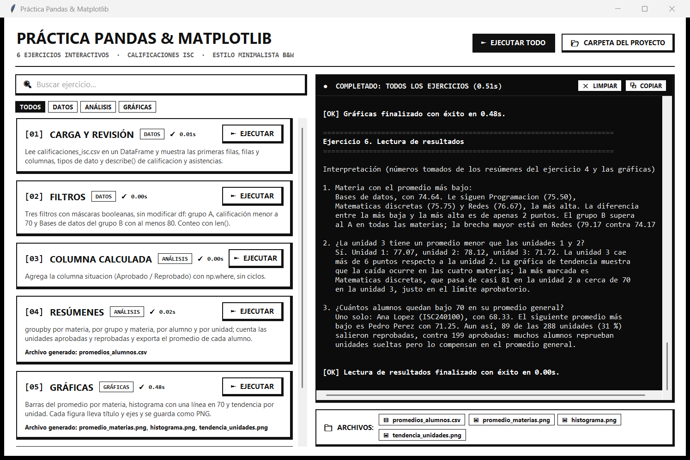
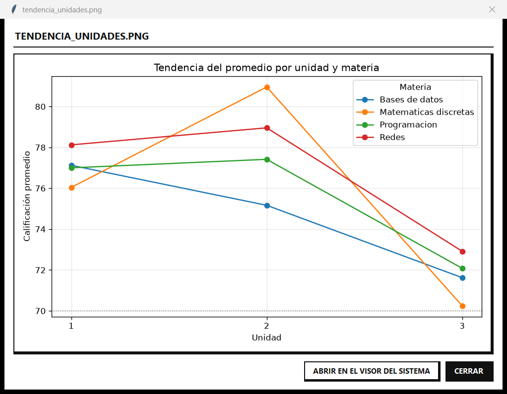
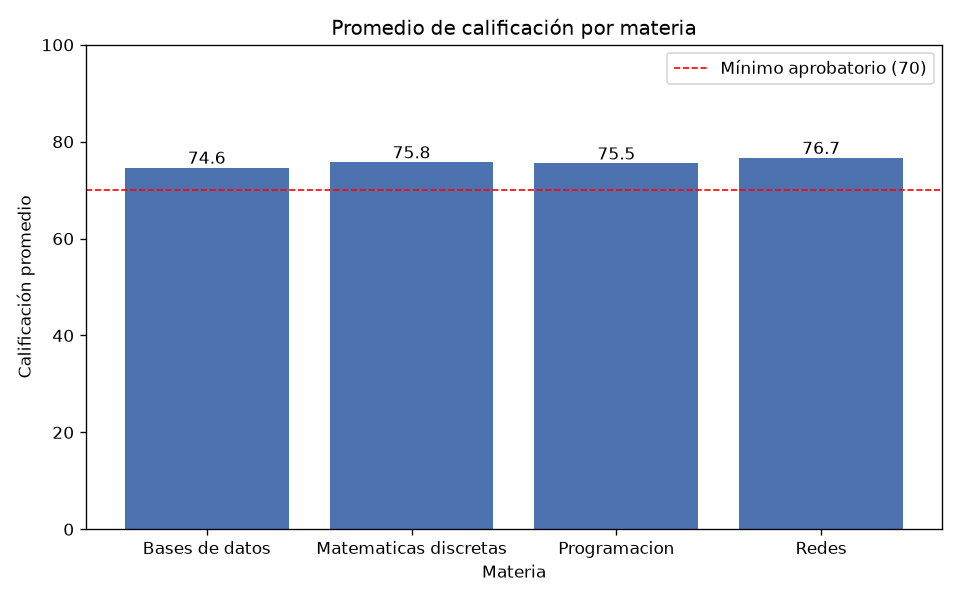
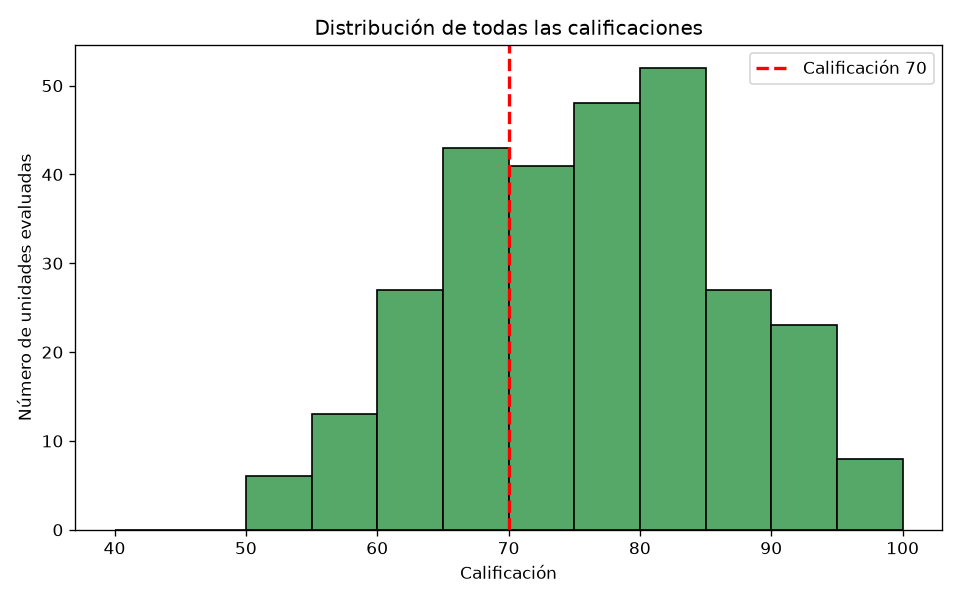
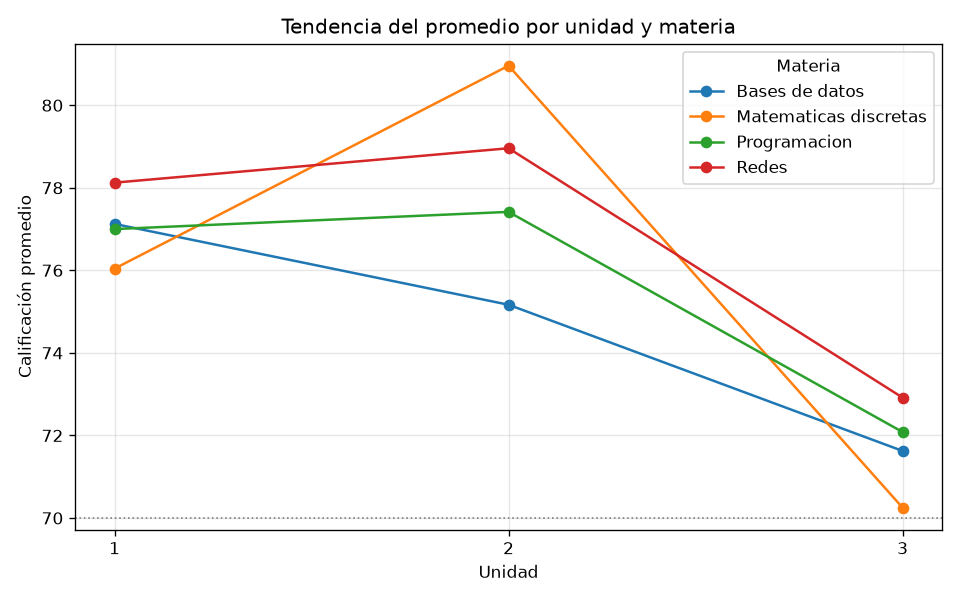

# Práctica Pandas & Matplotlib

Análisis y visualización de calificaciones de una generación de **Ingeniería en Sistemas Computacionales**. El programa usa **Pandas** para cargar, filtrar y resumir los datos, y **Matplotlib** para las gráficas. También tiene una **interfaz gráfica** en blanco y negro para ejecutar cada ejercicio por separado.

> Práctica de laboratorio de *Tópicos Avanzados de Programación*.
> Tecnológico Nacional de México · Instituto Tecnológico de Ciudad Madero.



---

## Contenido

| Archivo | Descripción |
|---|---|
| `practica_pandas.py` | Los seis ejercicios de la práctica, cada uno en su función. Se puede ejecutar solo en consola. |
| `interfaz.py` | Ventana con tkinter para ejecutar los ejercicios y ver los resultados. |
| `calificaciones_isc.csv` | Datos de entrada: 288 registros. |
| `promedios_alumnos.csv` | Promedio general de cada alumno, generado por el ejercicio 4. |
| `promedio_materias.png` | Gráfica de barras del promedio por materia. |
| `histograma.png` | Distribución de todas las calificaciones, con una línea en 70. |
| `tendencia_unidades.png` | Promedio por unidad, con una línea por materia. |
| `docs/` | Capturas de la interfaz que se muestran en este README. |

## Conjunto de datos

`calificaciones_isc.csv` tiene **288 filas**: 24 alumnos en dos grupos (A y B), 4 materias y 3 unidades por materia (24 × 4 × 3 = 288). Cada fila es **una unidad evaluada**, no un alumno.

| Columna | Tipo | Significado |
|---|---|---|
| `matricula` | texto | Identificador del alumno, por ejemplo `ISC240100` |
| `nombre` | texto | Nombre del alumno |
| `grupo` | texto | `A` o `B` |
| `materia` | texto | Programacion, Bases de datos, Redes o Matematicas discretas |
| `unidad` | entero | 1, 2 o 3 |
| `calificacion` | entero | De 0 a 100 |
| `asistencias` | entero | Asistencias registradas en la unidad |

## Requisitos

- Python 3.10 o superior
- pandas, numpy, matplotlib
- Pillow (opcional): se usa en la vista previa de las gráficas
- tkinter (viene incluido con Python en Windows)

```bash
pip install pandas numpy matplotlib pillow
```

## Uso

### Interfaz gráfica

```bash
python interfaz.py
```

- **► EJECUTAR** en cada tarjeta corre un ejercicio. **► EJECUTAR TODO** (o la tecla **F5**) corre los seis en orden.
- El buscador y las pestañas **TODOS / DATOS / ANÁLISIS / GRÁFICAS** filtran las tarjetas.
- La consola muestra la salida de cada ejercicio. **LIMPIAR** (Ctrl+L) la borra y **COPIAR** la copia al portapapeles.
- La barra **ARCHIVOS** muestra lo que se ha generado. Las gráficas se abren en una vista previa y el CSV en el programa predeterminado.
- Los ejercicios corren en un hilo aparte, así que la ventana no se congela.



### Consola

```bash
python practica_pandas.py
```

Imprime los resultados de los seis ejercicios, genera los archivos y muestra las tres gráficas.

Los archivos se leen y se guardan en la carpeta del script, sin importar desde dónde se ejecute.

## Ejercicios

| # | Ejercicio | Qué hace |
|---|---|---|
| 1 | Carga y revisión | `read_csv`, `head()`, `shape`, `dtypes` y `describe()` de calificación y asistencias. |
| 2 | Filtros | Máscaras booleanas sin modificar `df`: grupo A, calificación < 70, y Bases de datos del grupo B con ≥ 80. Conteo con `len()`. |
| 3 | Columna calculada | Columna `situacion` (Aprobado / Reprobado) con `np.where`, sin ciclos. |
| 4 | Resúmenes | `groupby` por materia, por grupo y materia, por alumno y por unidad, más `value_counts()` de la situación. Exporta `promedios_alumnos.csv` con `reset_index()` e `index=False`. |
| 5 | Gráficas | Barras, histograma y líneas, con título y ejes. Cada figura se guarda con `savefig` antes de `show`. |
| 6 | Lectura de resultados | Interpretación de los números obtenidos. |

## Resultados

| Gráfica de barras | Histograma | Tendencia por unidad |
|---|---|---|
|  |  |  |

**Hallazgos principales**

- **Materia con el promedio más bajo:** Bases de datos, con **74.64**. La más alta es Redes, con 76.67. El grupo B supera al grupo A en las cuatro materias.
- **Caída en la unidad 3:** los promedios son 77.07 en la unidad 1, 78.12 en la unidad 2 y **71.72** en la unidad 3. La caída aparece en todas las materias y es más marcada en Matemáticas discretas, que queda cerca de 70.
- **Alumnos con promedio menor a 70:** solo **uno**, Ana Lopez, con 68.33. Aun así, 89 de las 288 unidades (31 %) salieron reprobadas.

## Autor

- **Nombre:** _(completar)_
- **Número de control:** _(completar)_
- **Docente:** Alejandro Estrada Padilla

---

Proyecto desarrollado con apoyo de IA ([Claude Code](https://claude.com/claude-code)).
